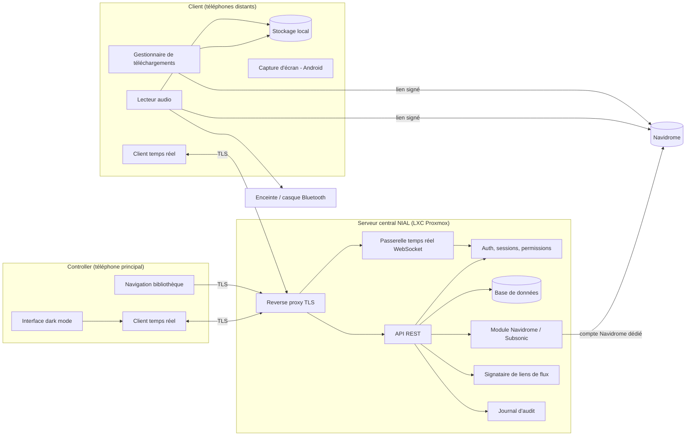
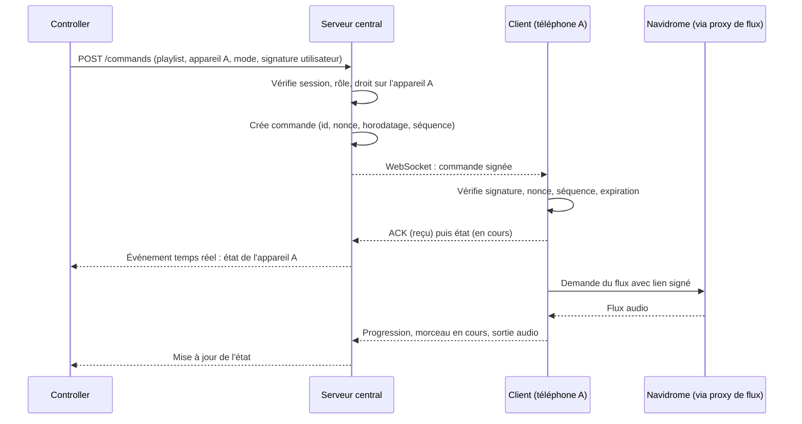
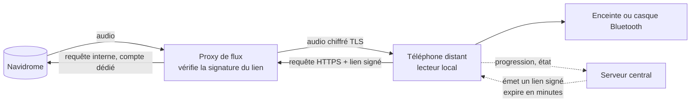
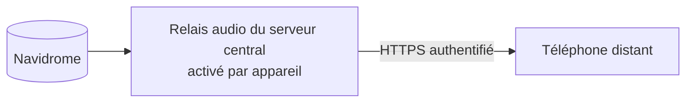
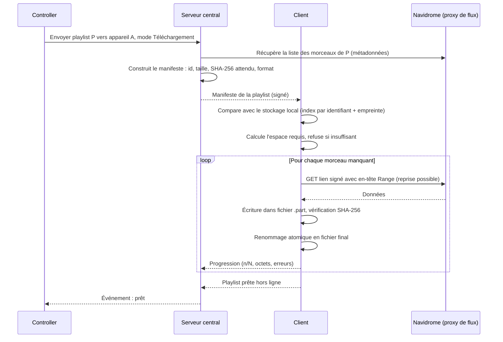
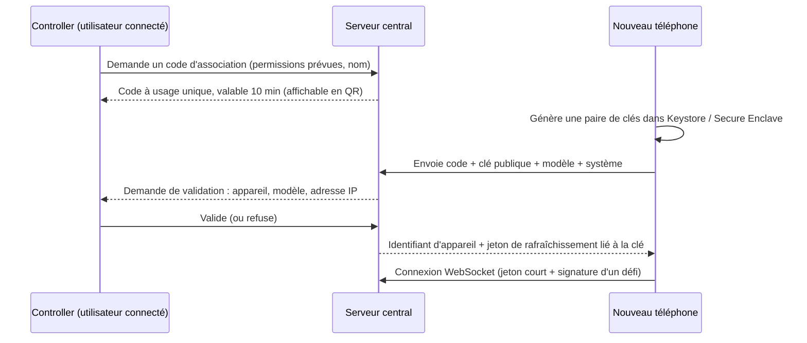

# 02 — Architecture recommandée

Les schémas sont en Mermaid : GitHub les affiche directement.

## 1. Vue d'ensemble des trois composants

Principe : **le serveur central transporte des commandes et des métadonnées, pas de l'audio**, sauf relais optionnel.

## 2. Communications

Règles du canal temps réel :
- Un seul canal WebSocket par appareil et par Controller, authentifié à la connexion (jeton court + preuve de possession de clé).
- Chaque message porte : identifiant, type, horodatage, nonce, numéro de séquence, signature.
- Une commande expire (par défaut 30 s) ; une commande rejouée ou hors séquence est rejetée.
- À la reconnexion, l'appareil envoie un instantané d'état complet et reçoit les commandes en attente non expirées.

## 3. Flux audio direct Navidrome → téléphone → Bluetooth

Points clés :
1. Le serveur central ne voit pas passer l'audio : il émet seulement le lien signé.
2. Le lien contient : identifiant d'appareil, identifiant de morceau, expiration, signature HMAC. Il n'expose aucun identifiant Navidrome.
3. Le proxy de flux refuse toute requête dont la signature, l'expiration, l'appareil ou le morceau ne correspondent pas, et limite le débit par appareil.
4. Le lecteur renouvelle les liens avant expiration (demande au serveur, qui revérifie la permission).

### Relais audio optionnel

Si un téléphone ne peut pas joindre le proxy de flux (réseau filtré, pas de route) :

- Désactivé par défaut, activable par appareil par un administrateur.
- Mêmes contrôles d'autorisation, avec limite de débit et de connexions simultanées pour protéger le serveur.
- Journalisé : durée et volume transférés.

## 4. Système de téléchargement

Détails :
- **Pas de doublon** : un morceau est identifié par son identifiant Navidrome et son empreinte. S'il est déjà présent, il n'est pas retéléchargé, même s'il appartient à plusieurs playlists.
- **Mise à jour intelligente** : le serveur recalcule le manifeste, le client télécharge seulement les ajouts, supprime les morceaux qui ne sont plus référencés par aucune playlist.
- **Reprise** : fichier `.part` conservé, requêtes `Range`, validation finale par empreinte.
- **Suppression à distance** : commande signée `purge(playlist | tout)`, confirmée par l'appareil.
- **Hybride** : le lecteur privilégie le fichier local s'il existe ; sinon il bascule sur le flux ; en cas de coupure, il bascule sur le local.

Remarque : Navidrome ne fournit pas d'empreinte de fichier. Le serveur central calcule et met en cache les SHA-256 en lisant chaque morceau une fois (ou à défaut le client enregistre l'empreinte au premier téléchargement et le serveur la compare entre appareils). Le choix est à valider à l'étape 4.

## 5. Authentification et association d'appareils

- **Utilisateurs** : mot de passe haché avec Argon2id, sessions à jeton d'accès court (15 min) + jeton de rafraîchissement rotatif (révocable), limitation de tentatives, verrouillage progressif.
- **Appareils** : authentification par clé asymétrique (le serveur ne détient que la clé publique). La révocation coupe immédiatement la WebSocket et invalide les liens signés.
- **Rôles** : `admin` et `user`. Les permissions par appareil sont granulaires : `music.control`, `music.send`, `device.status`, `screen.view`, `screen.control`, `files.manage`. `screen.*` n'est jamais accordé par défaut.
- **Réinitialisation du mot de passe** : par e-mail (SMTP configurable) ou, en mode sans e-mail, par commande d'administrateur en ligne de commande.

## 6. Fonctionnement de chaque composant

### Serveur central
Modules : `auth`, `users`, `devices`, `pairing`, `commands`, `realtime`, `navidrome`, `streams` (liens signés et relais), `downloads` (manifestes), `audit`, `health`. Chaque module expose une interface claire et ne touche pas la base d'un autre module directement. Tâches de fond : purge des commandes expirées, rotation des clés de signature, sauvegardes.

### Client (téléphone distant)
Couches : réseau et reconnexion, vérification des messages, exécuteur de commandes, lecteur audio, gestionnaire de téléchargements et d'index local, module Bluetooth/sortie audio (lecture de l'état), module capture d'écran (Android, isolé et désactivé sans permission).

### Controller
Couches : session et stockage sécurisé des jetons, abonnement temps réel (état de tous les appareils), bibliothèque Navidrome (via l'API du serveur, jamais directement), lecteurs multiples indépendants, tableau de bord, écran de visualisation à distance.

## 7. Choix de conception transverses

- **Modèle d'état** : le serveur est la source de vérité pour les commandes, l'appareil pour son état réel. L'état affiché dans le Controller est toujours daté (« dernière mise à jour il y a X s »).
- **Idempotence** : chaque commande a un identifiant ; l'appareil ignore un doublon.
- **Évolutivité** : serveur sans état de session en mémoire à terme (jetons + base), passerelle temps réel séparable plus tard ; pour un usage personnel (dizaines d'appareils) un seul processus suffit.
- **Observabilité** : journaux structurés JSON, endpoint de santé, métriques Prometheus optionnelles.
